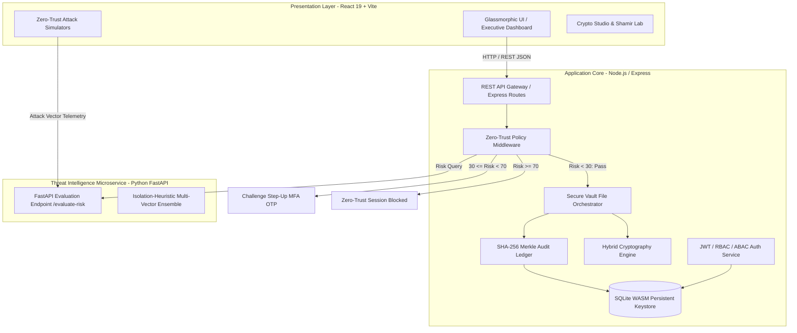

# SentinelVault Enterprise System Architecture & Cryptographic Specification

## 1. Executive Overview

**SentinelVault** is an intelligent, zero-trust cloud storage platform engineered to eliminate single points of failure in data confidentiality, integrity, and access authorization. Traditional cloud storage architectures rely heavily on perimeter security and static role-based access control (RBAC), leaving data vulnerable to insider threats, credential theft, and database tampering. 

SentinelVault enforces a continuous, multi-layered security architecture:
1. **Hybrid Envelope Cryptography**: Combines the high-throughput symmetric encryption of **AES-256-GCM** with asymmetric **RSA-2048/4096 OAEP** key wrapping and **PBKDF2** passphrase protection.
2. **Shamir's Secret Sharing (SSS)**: Distributes master recovery keys across a $2^{1024} + 643$ Galois prime field using Lagrange polynomial interpolation.
3. **AI-Driven Behavioral Threat Intelligence**: A Python FastAPI microservice utilizing Isolation Forest heuristics to evaluate geographic velocity, temporal distributions, behavioral spikes, and cryptographic failures in real time.
4. **Continuous Zero-Trust & Step-Up MFA**: Middleware that intercepts requests dynamically, enforcing 6-digit One-Time Password (OTP) verification when anomaly risk scores exceed threshold boundaries.
5. **Immutable Merkle Audit Ledger**: Cryptographic chaining of all transaction records where each log entry embeds the SHA-256 hash of its predecessor, ensuring immediate detection of database tampering.

---

## 2. High-Level 3-Tier System Architecture

---

## 3. Cryptographic Mathematical Foundations

### 3.1 Hybrid Envelope Encryption Pipeline
To encrypt large files efficiently while maintaining asymmetric key distribution:
1. **Data Encryption Key (DEK) Generation**: An ephemeral 256-bit symmetric key $K_{DEK}$ and a 96-bit Initialization Vector $IV$ are generated via `crypto.randomBytes()`.
2. **Symmetric Payload Encryption**:
   $$C, T = \text{AES-GCM}_{K_{DEK}}(P, IV)$$
   Where $P$ is the plaintext document, $C$ is the resulting ciphertext, and $T$ is the 128-bit authentication tag ensuring authenticated encryption with associated data (AEAD).
3. **Asymmetric Key Wrapping**: The user's private key $K_{priv}$ is unlocked from keystore using PBKDF2 ($100,000$ iterations of SHA-256). The DEK is wrapped using the user's RSA public key $K_{pub}$:
   $$W_{DEK} = \text{RSA-OAEP}_{K_{pub}}(K_{DEK})$$
4. **Storage Persistence**: Only $\{C, IV, T, W_{DEK}\}$ are stored in the database. $K_{DEK}$ and $P$ are immediately purged from system RAM.

### 3.2 Shamir's Secret Sharing over Galois Prime Field
To split a root secret $S$ (such as a master vault recovery passphrase) into $N$ shares with threshold $K$:
1. Define a 1025-bit prime number $p = 2^{1024} + 643$ defining the finite field $\mathbb{F}_p$.
2. Convert secret string $S$ into integer $a_0 < p$.
3. Generate random coefficients $a_1, a_2, \dots, a_{K-1} \in \mathbb{F}_p$.
4. Construct the degree $K-1$ polynomial:
   $$f(x) = a_0 + a_1x + a_2x^2 + \dots + a_{K-1}x^{K-1} \pmod p$$
5. Evaluate $f(x)$ at $N$ distinct points $x \in \{1, 2, \dots, N\}$ to generate shares $(x_i, y_i)$.
6. **Lagrange Reconstruction**: Given any $K$ shares, reconstruct root secret $a_0 = f(0)$:
   $$f(0) = \sum_{i=1}^{K} y_i \prod_{\substack{j=1 \\ j \neq i}}^{K} \frac{-x_j}{x_i - x_j} \pmod p$$

---

## 4. Immutable Merkle Hash Chaining

To prevent malicious SQL injection or unauthorized admin modifications to audit records, SentinelVault structures audit logs as a blockchain-inspired Merkle chain.

For block $i$:
$$H_i = \text{SHA256}(H_{i-1} \parallel T_i \parallel U_i \parallel A_i \parallel R_i \parallel P_i)$$

Where:
- $H_{i-1}$: Stored SHA-256 hash of block $i-1$ (Genesis block uses `000000...`).
- $T_i$: ISO-8601 Timestamp.
- $U_i, A_i, R_i$: User ID, Action Type, and Target Resource ID.
- $P_i$: SHA-256 digest of request payload.

When verification is executed (`/api/audit/verify`), the engine iterates from block $1$ to $N$, recomputes $H_i$, and compares against stored hashes. Any discrepancy flags the exact tampered block immediately.
